# Screenshots

All pictures show the made-up demo library that `scripts/demo_library.py` builds: every title, network, rating and poster
in them is invented. Posters are generated artwork. The page follows your system's light or dark setting until you pick
one with the button in the header.

## Up Next

The next episode of everything you are watching. One tap marks it watched.

## Library

Every title as a card, filtered and sorted by status, service, audience or any rating source (the "CC" badge is a custom
rating source).

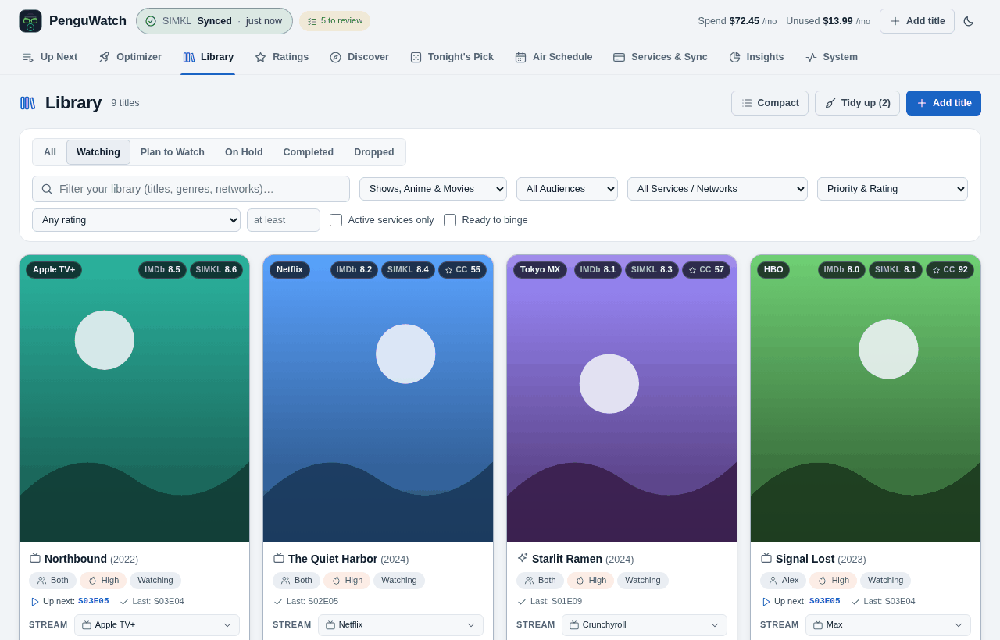

## Title details

Status, your rating, who is watching, priority, the service it streams on, notes and every rating source.

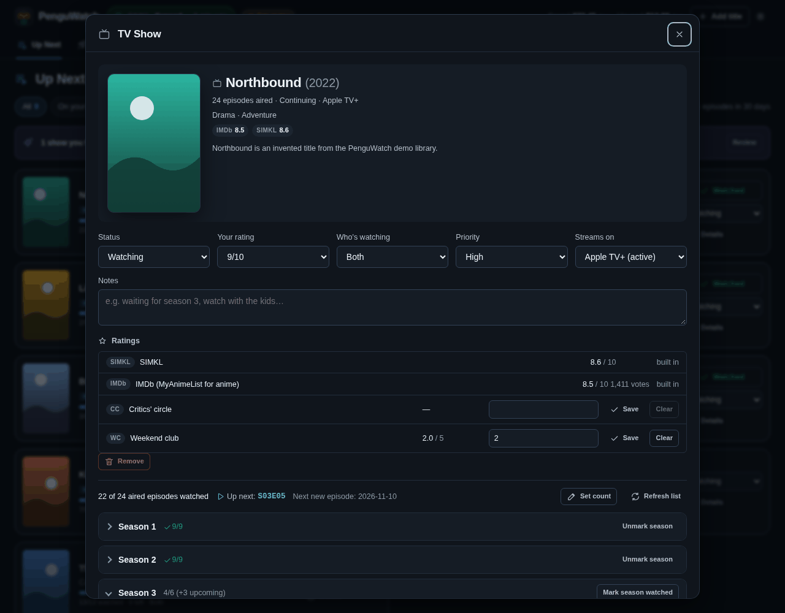

## Optimizer and rotation plan

What you pay, which service you could cancel, and what to subscribe to next.

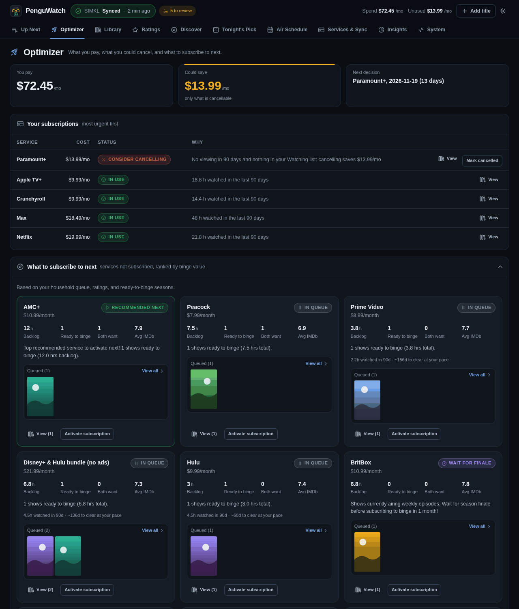

## Tonight's Pick

A weighted random pick from your backlog, filtered by what you can watch tonight.

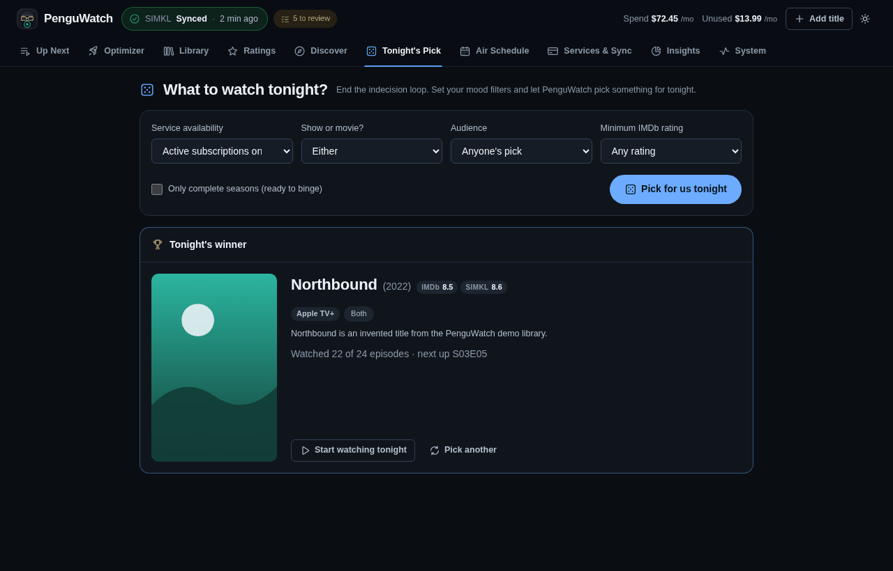

## Air schedule

Upcoming episodes of the titles you track, and the link for your calendar app.

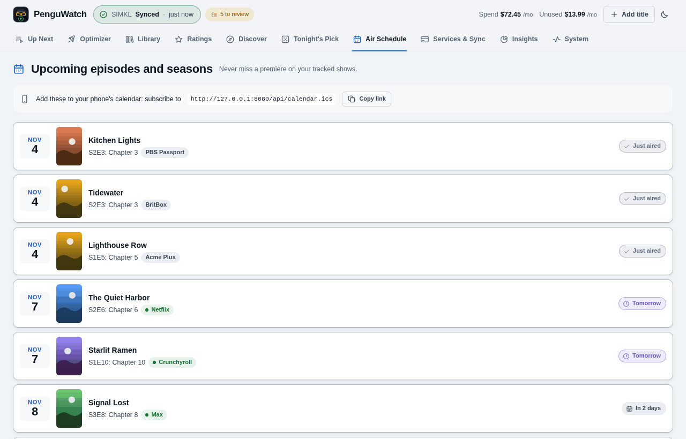

## Ratings

Built-in and custom rating sources, and the CSV import.

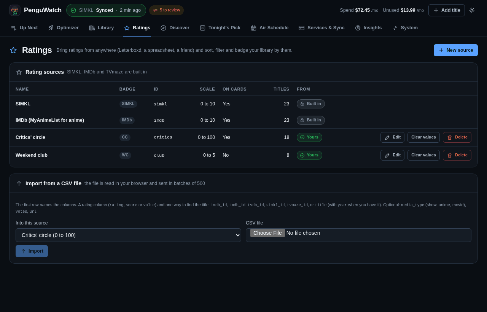

## Services & Sync, and data credits

The library service's connection (SIMKL here), the review setting, and the credit TVmaze's licence asks for. (This picture puts three panels of
the page side by side; on the real page they sit apart, with the list of services between them.) It comes from a setup with
`drivers: {catalog: [tvmaze, simkl], schedule: [tvmaze]}`.

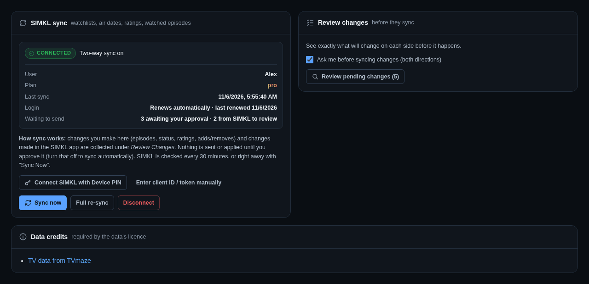

## Review dialog

With review mode on, nothing is sent to or taken from the account until you approve it.

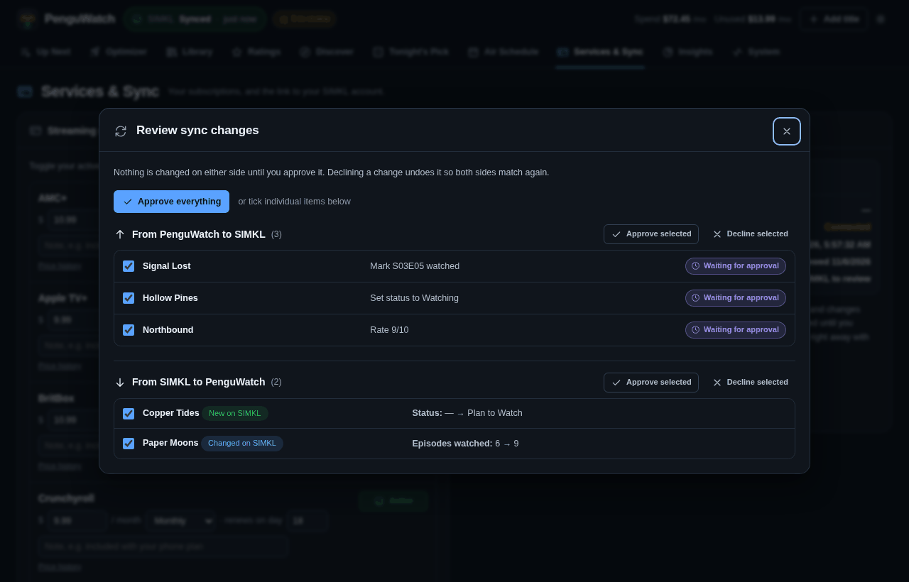

## Tidy dialog

Finished shows with new episodes, shows you have not touched for months, and titles with no streaming service.

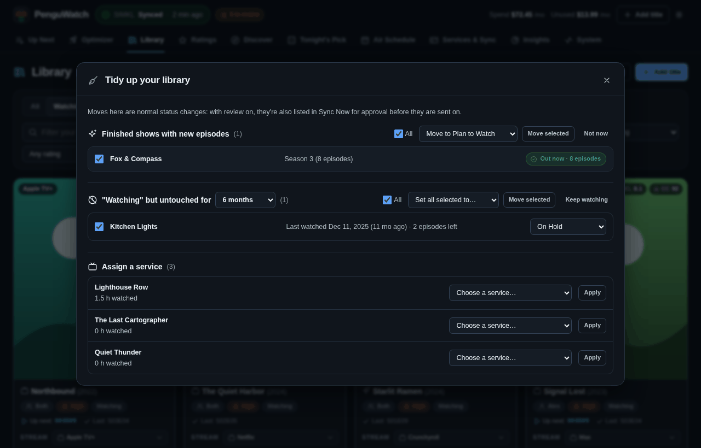

## On a phone

Up Next and the Library on a phone, with the bottom tab bar.

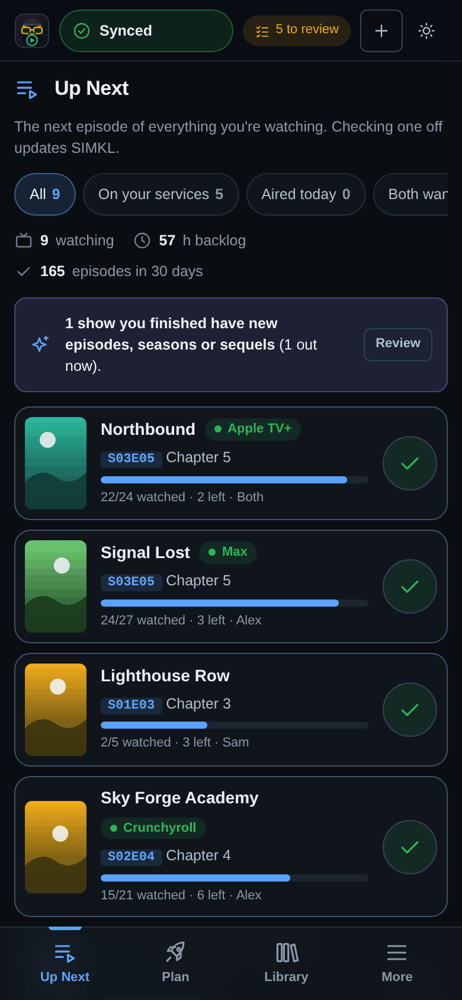 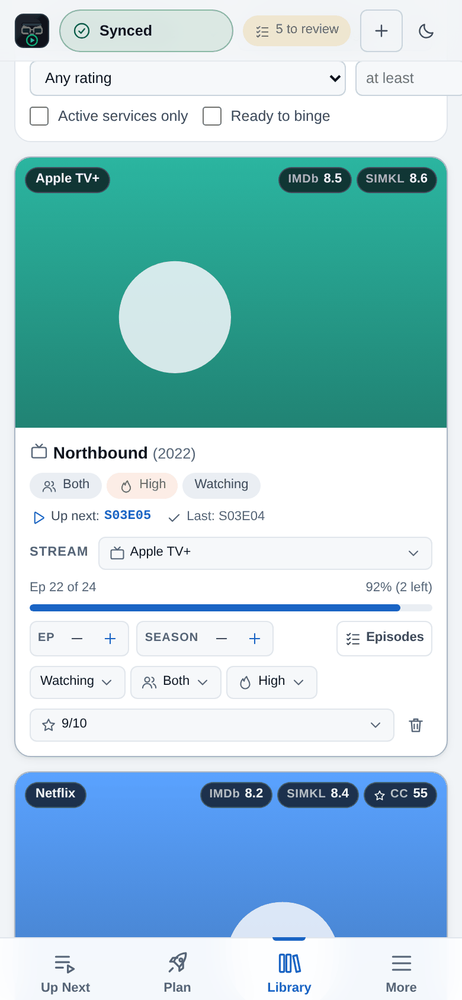
