# Screenshots

All pictures show the made-up demo library that `scripts/demo_library.py` builds: every title, network, rating and poster
in them is invented. Posters are generated artwork. The page follows your system's light or dark setting until you pick
one in the header's theme menu, which also picks the theme ([Themes](themes.md)).

## Up Next

The next episode of everything you are watching. One tap marks it watched.

## Library

Every title as a card, filtered and sorted by status, service, audience or any rating source (the "CC" badge is a custom
rating source).

## Title details

Status, your rating, who is watching, priority, the service it streams on, notes and every rating source.

## Optimizer and rotation plan

What you pay, which service you could cancel, and what to subscribe to next.

## Tonight's Pick

A weighted random pick from your backlog, filtered by what you can watch tonight.

## Air schedule

Upcoming episodes of the titles you track, and the link for your calendar app.

## Ratings

Built-in and custom rating sources, and the CSV import.

## Services & Sync, and data credits

The library service's connection (SIMKL here), the review setting, and the credit TVmaze's licence asks for. (This picture puts three panels of
the page side by side; on the real page they sit apart, with the list of services between them.) It comes from a setup with
`drivers: {catalog: [tvmaze, simkl], schedule: [tvmaze]}`.

## Review dialog

With review mode on, nothing is sent to or taken from the account until you approve it.

## Tidy dialog

Finished shows with new episodes, shows you have not touched for months, and titles with no streaming service.

## On a phone

Up Next and the Library on a phone, with the bottom tab bar.

 

## History

What you watched in the last 30 days (7 days and 12 months are one click away), compared with the period before.

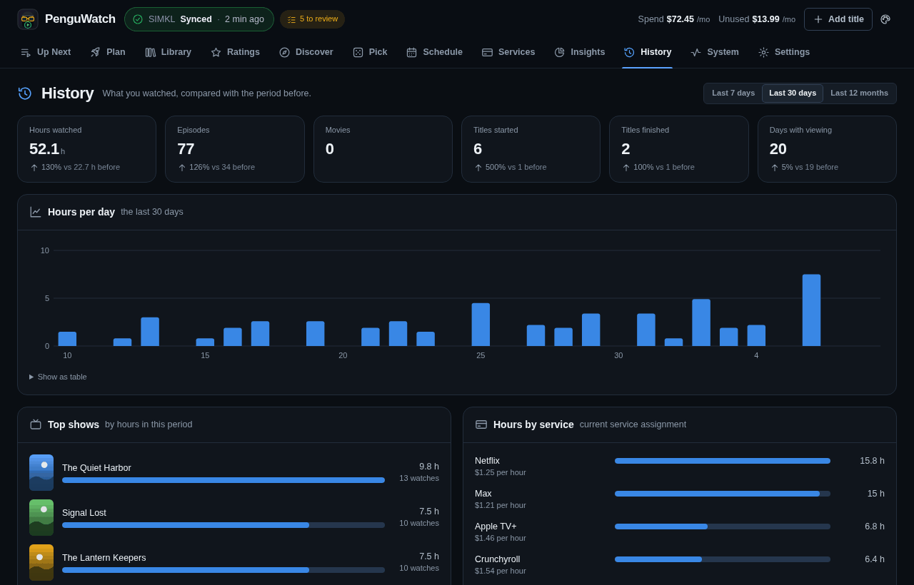 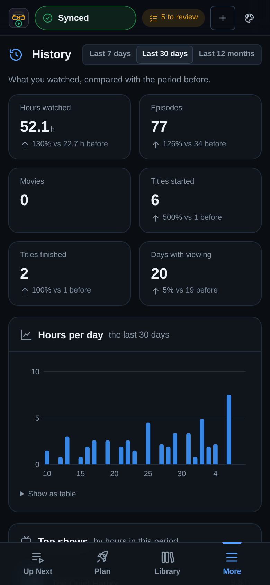

## Settings

The Settings tab: everything that used to be in `config.yaml`, changed in the app. The picture shows the top of the page; the
phone picture shows the same page with nothing changed. The warning about the access token is there because the demo runs
without one.

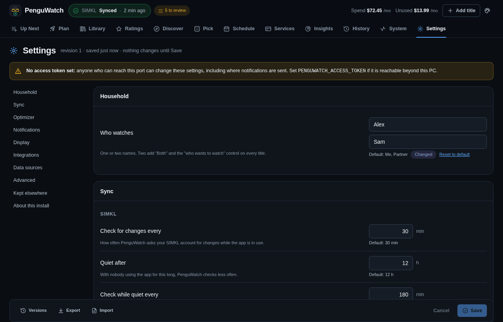 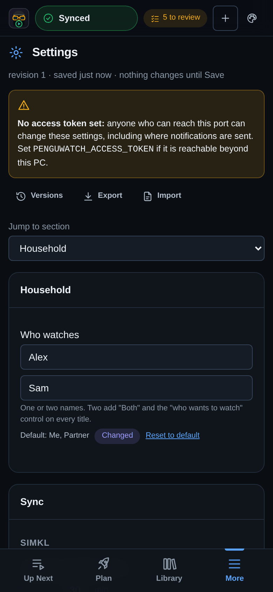

## Themes

The same page, Up Next, in six of the seven themes ([Themes](themes.md)): PenguWatch (the default), Nord, Dracula, E-ink (a
light-only theme), High contrast and Blueprint (with its grid-paper background). Solarized is the seventh. Every theme but
the one-mode ones also has a light and a dark palette.

The header's theme menu, open: the theme for this browser, and light, dark or like the system.

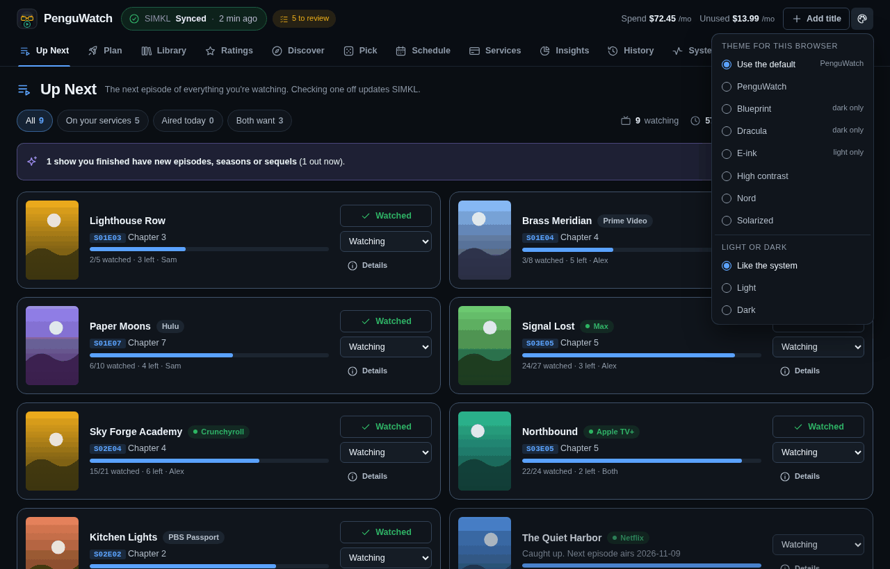

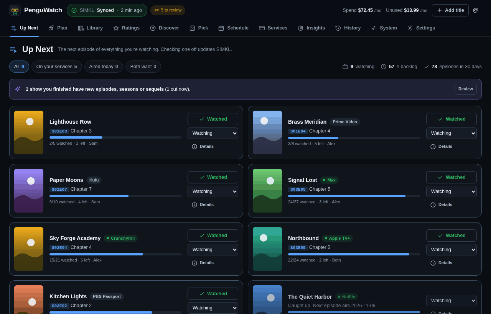
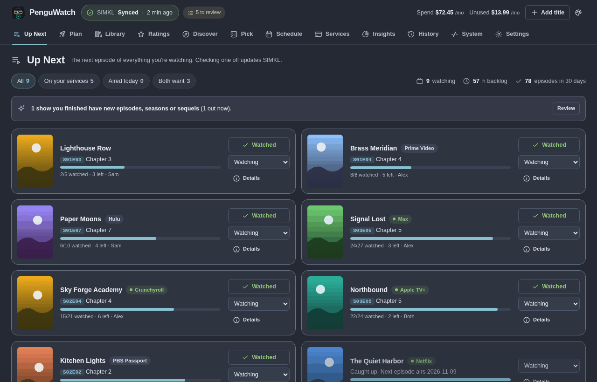
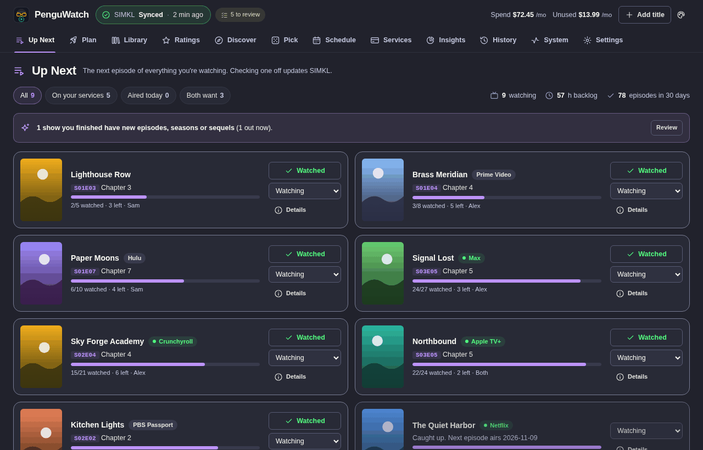
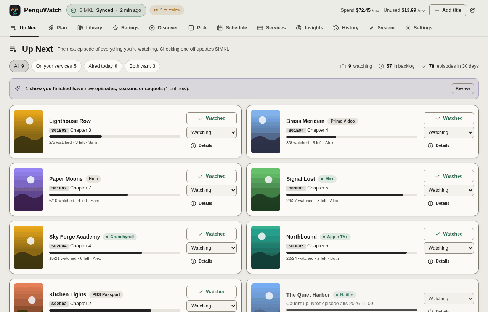
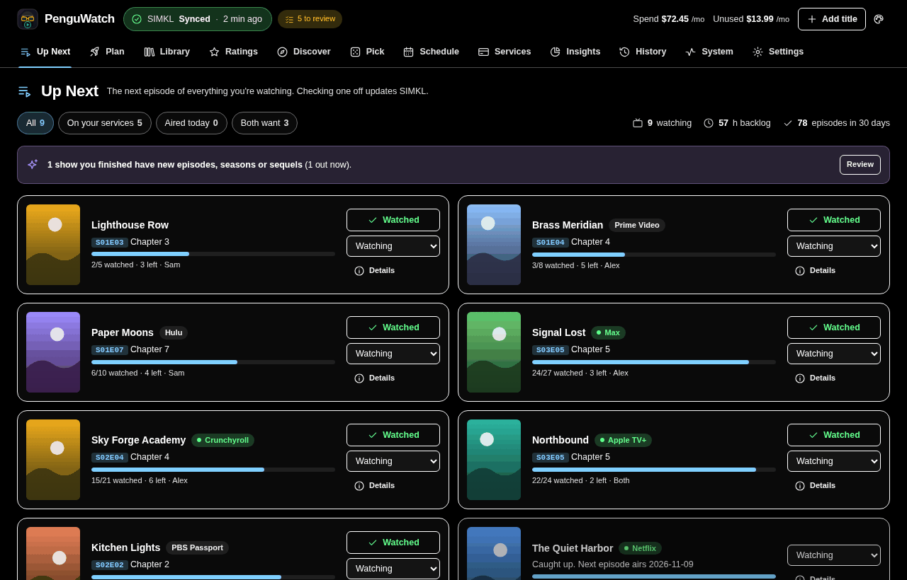
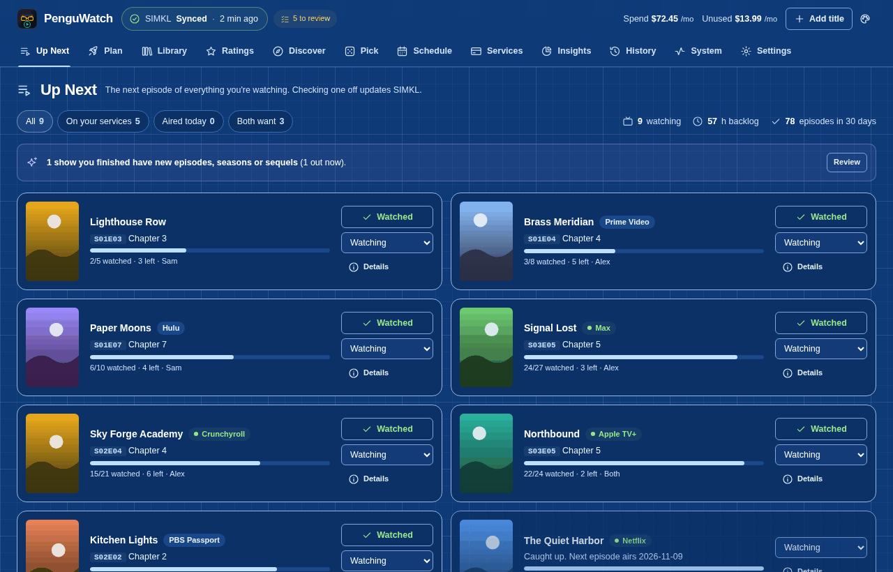

## How they were made

Every picture is a headless Chromium screenshot of the demo library (`scripts/demo_library.py --signed-in`) at 1280x820
(the tall ones at 1280x1000 and 1280x1500), or 390x844 at twice the pixel ratio for the phone ones, in the dark or the
light setting of the system. They run offline, so the demo's made-up SIMKL login is shown as a sync that went through.
Each is quantised to a 256-colour palette and written without any metadata chunk.
